<div align="center">



<br/>


</div>

A tiny, **zero-dependency** command-line snippet manager. Save commands, code and notes,
tag them, search them instantly, and copy them to your clipboard — all from the terminal.

Everything is stored in one human-readable JSON file (`~/.snipbox/snippets.json`),
so it's easy to back up, sync (Dropbox, git, Syncthing…) or edit by hand.

## ✨ Features

- Add snippets from an argument, a pipe, or interactively
- Tags and full-text search (all search words must match)
- Copy to clipboard (`pbcopy`, `wl-copy`, `xclip`, `xsel`, `clip`)
- Safe atomic writes: your data file is never left half-written
- Full Unicode support (Persian, emoji, etc.)
- Pure Python standard library, Python 3.8+

## 📦 Install

```bash
git clone https://github.com/ERROR404DTIR/snipbox.git
cd snipbox
pip install .
```

Or run without installing: `python -m snipbox.cli --help`

## 🚀 Usage

```bash
# add
snipbox add "git undo last commit" "git reset --soft HEAD~1" -t git -t undo
echo "docker system prune -af" | snipbox add "docker cleanup" -t docker

# find
snipbox list
snipbox list -t git
snipbox search git reset

# use
snipbox show 1
snipbox copy 1

# manage
snipbox tags
snipbox rm 2
snipbox export > backup.json
```

Example `list` output:

```text
   1  2026-11-07  git undo last commit                      [git,undo]
   2  2026-11-07  docker cleanup                            [docker]
```

### ⚙️ Configuration

| Variable        | Purpose                                | Default                    |
| --------------- | -------------------------------------- | -------------------------- |
| `SNIPBOX_FILE`  | Path to the snippets JSON file         | `~/.snipbox/snippets.json` |

## 🧪 Development

```bash
python -m unittest discover tests -v
```

## 📄 License

MIT
